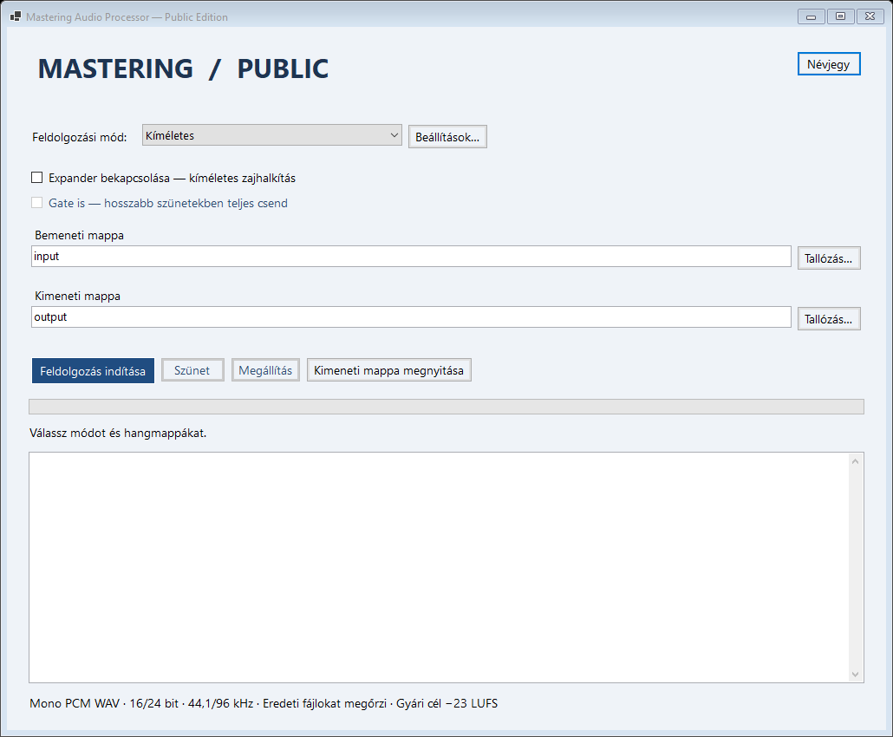

# Mastering Audio Processor

**C# / .NET 8 alapú Windows-program mono beszédfelvételek kötegelt feldolgozásához.**

[English](README.md) · [Fejlesztői útmutató](docs/DEVELOPMENT.md) · [GPL-3.0](LICENSE)



## Mit tud?

- Kezdő zajmintát használó **noisereduce stationary** zajszűrés, kikapcsolható móddal.
- Beállítható külön beszédkompresszor: küszöb, arány, knee, attack, release, előretekintés.
- Külön expander vagy gate, automatikus/kézi küszöbbel, hold és release idővel.
- LUFS-hangerőillesztés, alapból **−23 LUFS**, túlmintavételezett csúcsbecsléssel.
- Külön **−14 LUFS / −1,3 dBTP** játékpreset.
- Minden fül beállítását együtt mentő presetek, névütközésnél Felülír / Megtart / Mégse.
- Preset szerinti kimeneti almappák, számozott fájlnévütközés-kezelés.
- Háttérben futó feldolgozás, fájlhatáron szünet/folytatás és megállítás.
- Választható magyar/angol felület, magyar/angol fejlesztői kommentek és dokumentáció.

Ez önálló nyilvános kiadás, kizárólag az itt ismertetett feldolgozómodulokkal.
Működéséhez nincs szükség Pythonra, külön hangfeldolgozó programra, fiókra vagy
internetkapcsolatra. A repó jelenleg a C# kiadást tartalmazza.

## Indítás és fordítás

Windows x64 alatt telepítsd a **.NET 8 Desktop Runtime x64** környezetet a
[Microsoft oldaláról](https://dotnet.microsoft.com/en-us/download/dotnet/8.0),
csomagold ki a Windows-kiadást, majd indítsd a `MasteringAudioProcessor.exe` fájlt.

Forrásból Windows alatt, .NET 8-at célzó fordításra képes SDK-val (C# 12+):

```powershell
dotnet build src/Mastering.CSharp.csproj -c Release
& ./src/bin/Release/net8.0-windows/MasteringAudioProcessor.exe
```

Nincs külső NuGet-függőség. A Windows Desktop targeting packoknak telepítve kell
lenniük. A mellékelt `NuGet.Config` nem használ csomagforrást, így előkészített
gépen offline is fordítható.

## Nyelvválasztás

**Beállítások… → Felület → Nyelv / Language → Magyar vagy English → Mentés.**
A főablak rögtön átvált, a választás a következő indításra is megmarad. A magyar
az alapértelmezett; a Mégse elveti a még nem mentett nyelvválasztást.

A nyelv külön felületi beállítás, nem része a hangpreseteknek: nem módosítja a
DSP értékeit, nem jelöli módosítottnak a presetet és nem változtatja meg a hangot.
A magyar felületen a nemzetközi szakkifejezések angolul maradnak: Threshold,
Ratio, Attack, Hold, Release, Lookahead, Knee, True Peak, Compressor.
Az alkalmazás üzenetei és a napló leíró szövegei is követik a választást. A már
kiírt naplósorok megmaradnak; a rendszerablakok és rendszerhibák nyelve Windows
szerinti lehet. A fájl- és presetnevek változatlanok.

## Használat

Támogatott: **mono, tömörítetlen PCM WAV, 16/24 bit, 44,1/96 kHz**. A program
megtartja a mintavételt, mintaszámot és bitmélységet; az extra WAV-metaadatokat
nem másolja át. Az almappákba nem lép be.

1. Tedd a hangokat az `input` mappába, vagy válassz bemeneti mappát.
2. A felvétel elején legyen csak alapzaj: alapból az első **250 ms** adja a
   zajmintát. Ebbe ne kerüljön beszéd.
3. Válassz módot: **Zajszűrés**, **Kíméletes** vagy **Játék**. A Beállításokban
   finomíthatsz és presetet menthetsz/tölthetsz be.
4. Adj meg külön kimeneti mappát, majd indítsd a feldolgozást.

Minden bemenethez egy feldolgozott WAV készül. Preset nélkül közvetlenül a
kimeneti mappába ment; `Voice One` presetnél annak `Voice_One` almappájába,
módosított presetnél `_modositott` toldással. Meglévő hangot nem ír felül:
névütközésnél `_new_001`, `_new_002` stb. toldást kap az új fájl.
A megállítás/szünet előtt az aktuális fájl még elkészül; a kész fájlok megmaradnak.

## Feldolgozási sorrend és korlátok

**Stationary zajszűrés vagy bypass → opcionális kompresszor → opcionális
expander/gate → LUFS/erősítés és csúcsvédelem → PCM export.** A zajminta még
a kompresszió és hangerőillesztés előtt készül. Nincs adaptív zajszűrés,
automatikus vágás vagy rejtett alapfeldolgozás.

A csúcsvédelem a teljes hangra alkalmazott egyenletes erősítést korlátozza,
**nem dinamikus limiter**. Kiugró tüskéknél a cél-LUFS alatt maradhat az eredmény.
A csúcsbecslés 16× túlmintavételezést és kis biztonsági tartalékot használ;
ez nem tanúsított mérőműszerre vonatkozó megfelelőségi állítás. Nagyon rövid vagy
néma hangnál nincs megbízható LUFS-érték. A zajmintánál rövidebb fájl zajszűréskor
hibát ad; bypass mellett feldolgozható. Az erős zajszűrés/gate halk beszédet is
érinthet, ezért hallgasd vissza az eredményt.

A Kíméletes és Játék alapértéke is −23 LUFS; a −14-es célhoz külön töltsd be a
**Game -14 LUFS** presetet. Más kiadások presetjeit ez a verzió nem tölti be.

## Parancssor és fejlesztés

A `--process` ugyanazt a motort futtatja felület nélkül. A `--language hu` vagy
`--language en` a parancssori üzenetek nyelvét választja ki. `--profile gentle`,
`--input`, `--output`, `--report`, illetve `--preset` vagy `--settings` adható meg.
A Windows GUI-exét várakozó indítással használd; az eredmény a jelentésben és a
kimeneti `log.txt` fájlban olvasható. Példák az [angol leírásban](README.md), XML
a `src/settings.xml` fájlban. A `--verify` új mappába generált teszthanggal ellenőriz.

[Magyar/angol fejlesztői útmutató](docs/DEVELOPMENT.md).

## Szerző és licenc

Készítette: **Ádám Sarkament**, AI segítségével. A stationary zajszűrés alapja
**Tim Sainburg noisereduce** projektje; MIT licencét megőriztük.
[Külső összetevők](src/THIRD_PARTY_NOTICES.md).

A saját projektkód licence **GPL-3.0-only**. Használható, módosítható és
továbbadható a licenc szerint; továbbadáskor a származtatott változat megfelelő
forrását is biztosítani kell, a kötelező megjelölések megtartásával és a
módosítások jelzésével. A teljes feltételeket a [LICENSE](LICENSE) tartalmazza.
A programhoz nem jár garancia.
