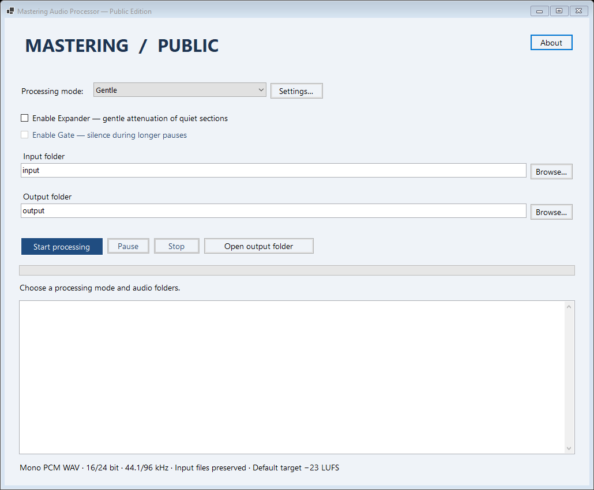
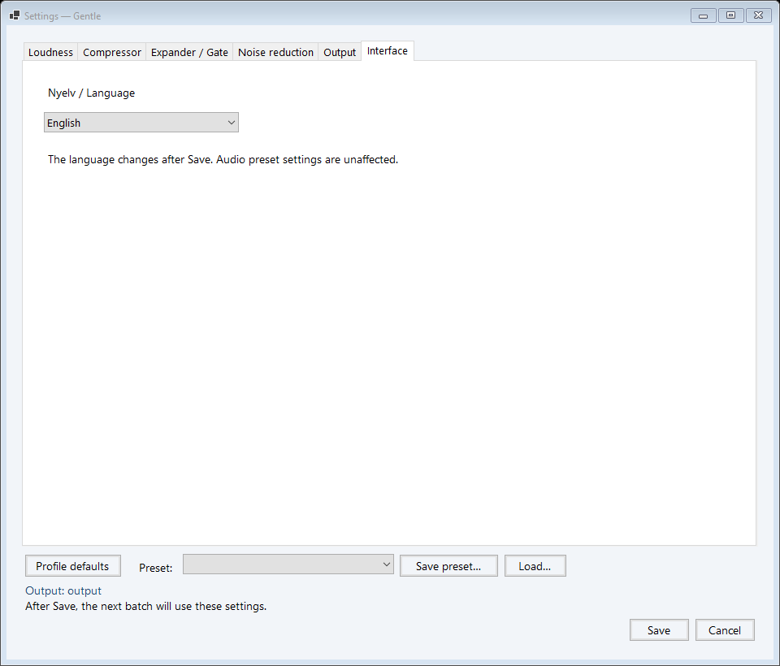

# Mastering Audio Processor

**A Windows desktop tool for batch processing mono speech recordings, written in C# and .NET 8.**

[Magyar leírás](README.hu.md) · [Developer guide / Fejlesztői útmutató](docs/DEVELOPMENT.md) · [GPL-3.0](LICENSE)



## Features

- Stationary noise reduction based on [noisereduce](https://github.com/timsainb/noisereduce), using an initial noise-only sample; optional bypass.
- Optional speech compression with threshold, ratio, knee, attack, release and lookahead controls.
- Optional downward expander or gate with automatic/manual threshold, hold and release.
- Integrated loudness matching, default **−23 LUFS**, and an oversampled true-peak estimate.
- A **−14 LUFS / −1.3 dBTP** game preset for recordings that need a higher playback level.
- Save/load all settings as a preset; explicit overwrite, keep-both or cancel when a name exists.
- Preset-based output folders, safe filenames and numbered duplicates; input audio is preserved.
- Background batch processing with pause/resume and stop **between files**.
- Switchable Hungarian/English interface, bilingual documentation and developer comments.

This is a standalone public edition. It contains only the processing modules
documented here. It does not require Python, an external audio executable, an
account or a network connection to process audio. The Python edition is not part
of this repository.

## Run

On Windows x64, install the **.NET 8 Desktop Runtime (x64)** from
[Microsoft](https://dotnet.microsoft.com/en-us/download/dotnet/8.0), then extract
a Windows package and run `MasteringAudioProcessor.exe`.

Alternatively, build from source with a Windows .NET SDK capable of targeting
.NET 8 (C# 12 or later):

```powershell
dotnet build src/Mastering.CSharp.csproj -c Release
& ./src/bin/Release/net8.0-windows/MasteringAudioProcessor.exe
```

The project has no external NuGet package dependencies. The SDK must have the
Windows Desktop targeting packs installed. A `NuGet.Config` with no package
sources is included for reproducible offline builds on a prepared machine.

## Interface language

Open **Beállítások… → Felület → Nyelv / Language**, choose **English**, and press
**Mentés**. In English, the path is **Settings… → Interface → Nyelv / Language →
Save**. The main window updates immediately and remembers the choice on the next
startup. Hungarian remains the default. Cancel discards a pending selection.

Language is a UI preference, separate from audio presets: switching it does not
change audio settings, mark a preset as modified, or affect the output samples.
Hungarian labels retain international audio terms such as Threshold, Ratio,
Attack, Hold, Release, Lookahead, Knee, True Peak and Compressor. Application
messages and log descriptions follow the selected language. Existing log entries
are preserved; operating-system dialogs and diagnostics may follow Windows'
language. File and preset names remain unchanged.



## Prepare recordings

Supported input: **mono, uncompressed PCM WAV, 16 or 24 bit, 44.1 or 96 kHz**.
The sample rate, sample count and bit depth are retained. Extra WAV metadata is
not copied. Subfolders are not scanned.

1. Put WAV files in `input`, or choose an input folder in the interface.
2. Leave a noise-only section at the beginning of each recording. By default,
   the first **250 ms** provide the noise profile. Keep speech out of that section.
3. Choose **Zajszűrés** (noise reduction only), **Kíméletes** (gentle), or **Játék**
   (game). Open **Beállítások…** to adjust parameters or load a preset.
4. Choose a separate output folder and start processing. A preset named
   `Voice One` writes to `output/Voice_One`; changed settings add `_modositott`.
   Without a preset, files go directly into the selected output folder.

One processed WAV is written per input file. Existing WAV files are not
overwritten; collisions receive `_new_001`, `_new_002`, and so on. Pause and stop
finish the current file first; completed files remain available.

## Processing and limits

The chain is: **stationary denoising or bypass → optional compressor → optional
expander/gate → loudness/gain matching with peak protection → PCM export**.
Noise is sampled before compression and normalization. There is no adaptive
denoising, automatic trimming or hidden preprocessing stage.

Peak protection limits the **uniform gain applied to the whole recording**; it
is not a dynamic brick-wall limiter. A spiky recording may remain below the
requested LUFS value to respect the peak ceiling. The estimate uses 16×
oversampling and a small safety margin, but is not a claim of certified meter
conformance. Loudness cannot be measured reliably for very short/silent clips;
clips shorter than the configured noise sample are rejected unless denoising is
bypassed. Strong denoising or gating can remove quiet speech—audition results.

Both gentle and game profiles start at −23 LUFS. Load **Game -14 LUFS** explicitly
for −14 LUFS / −1.3 dBTP. Presets from other editions are intentionally unsupported.

## Command line and tests

The same C# engine can run without opening the interface. Because the executable
is a Windows GUI application, use a process launcher that waits for completion;
read the report and `output/log.txt` for results.

```powershell
$app = Resolve-Path ./src/bin/Release/net8.0-windows/MasteringAudioProcessor.exe
Start-Process $app -Wait -ArgumentList '--process --profile gentle --input C:\Audio\input --output C:\Audio\output --report C:\Audio\run.json'
```

`--language en` or `--language hu` selects the language for CLI messages.
`--preset <file.json>` loads a public preset (its profile is used).
`--settings <file.xml>` loads a public XML configuration. Use one or the other.
Examples are in `src/settings.xml` and `src/Presets/`.

```powershell
# Use a new, nonexistent test directory; only synthetic audio is generated.
Start-Process $app -Wait -ArgumentList '--verify --test-dir C:\Audio\verification-new --report C:\Audio\verification.json'
```

Exit codes: `0` success, `1` configuration/verification error, `2` one or more
file failures, `130` stopped. For development details see [the guide](docs/DEVELOPMENT.md).

## Credits and licence

Created by **Ádám Sarkament**, with assistance from AI. Stationary denoising is
based on **Tim Sainburg's noisereduce**, with its MIT notice preserved.
See [third-party notices](src/THIRD_PARTY_NOTICES.md).

Original project code: **GPL-3.0-only**. You may use, modify and redistribute it
under that licence; distributed derivatives must provide corresponding source,
preserve required notices and identify changes. See the full [licence](LICENSE).
No warranty is provided.
